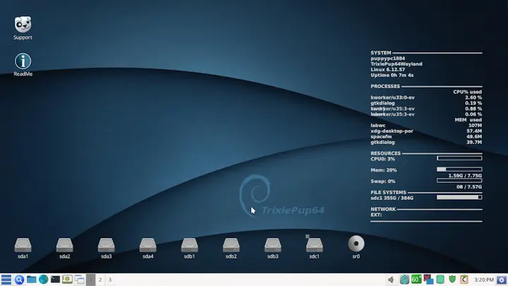
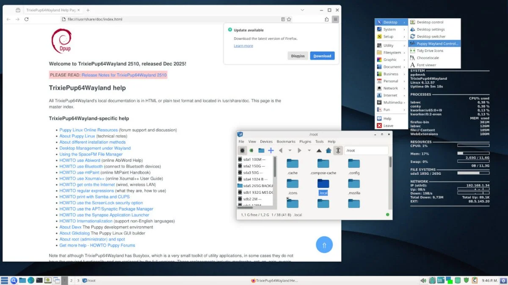
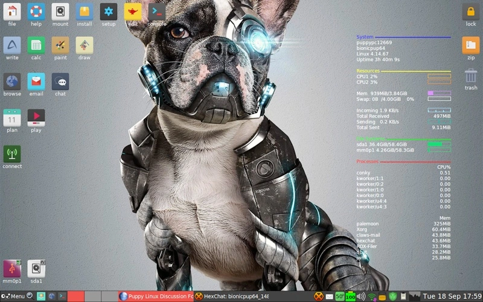
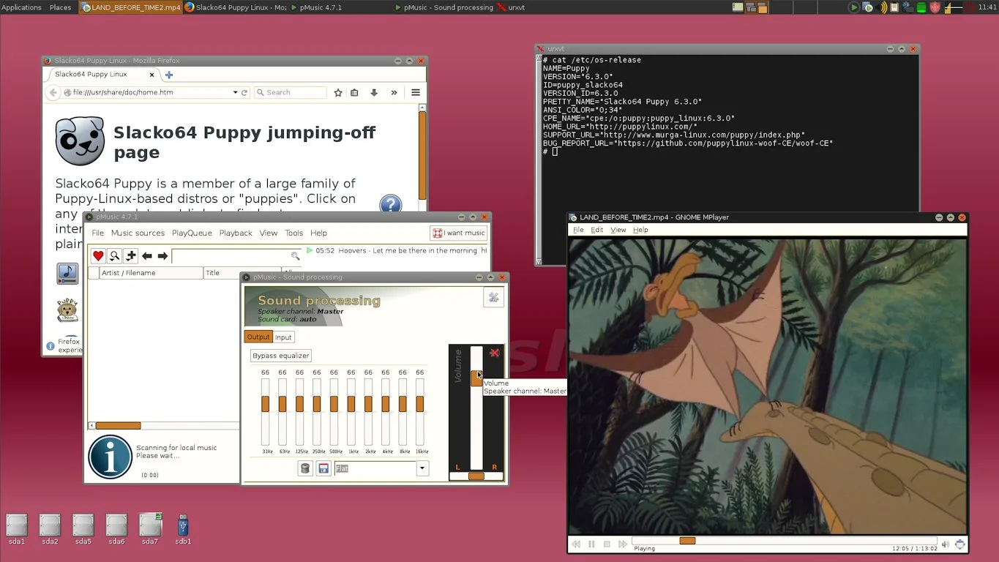

<main class="home-page">
  <section class="home-hero" aria-labelledby="home-title">
    

      
A friendly Linux family for everyday computers

      <h1 id="home-title">A fast, flexible OS for Single-user PCs.</h1>
      
Suitable for both modern and older PCs.

      

        Small, ready to use, and easy to try from a USB drive.
      

      

        <a class="home-button home-button-primary" href="https://forum.puppylinux.com/puppy-linux-collection">Download Puppy Linux</a>
        <a class="home-button home-button-secondary" href="#features">Explore features</a>
      

      
Free and open source &middot; Most variants are 1.5 GB or less

      

        &#10003; Maintained since 2003
        &#10003; Boots from USB
        &#10003; Runs well on modest hardware
      

    

    <figure class="home-visual">
      
      <figcaption>See the Puppy Linux desktop before you install it.</figcaption>
    </figure>
  </section>

  <section class="home-section" id="features" aria-labelledby="features-title">
    <h2 id="features-title">Small download. Big possibilities.</h2>
    

      Pick a Puppy that fits your hardware, then make it your own.
    

    

      <article class="home-card">
        <h3>Ready in minutes</h3>
        
Try it from a USB drive without changing your existing system.

      </article>
      <article class="home-card">
        <h3>Light on resources</h3>
        
Get a responsive desktop on modest hardware.

      </article>
      <article class="home-card">
        <h3>Make it yours</h3>
        
Choose a variant, desktop, and apps that suit you.

      </article>
      <article class="home-card">
        <h3>Helpful community</h3>
        
Find practical help from Puppy users around the world.

      </article>
    

  </section>

  <section class="home-section" aria-labelledby="why-title">
    

      

        <h2 id="why-title">A project with room to explore</h2>
        

          Since 2003, Puppy Linux has grown into a family of community-built distributions
          for different needs.
        

        

          Read the <a href="history.html">history</a>, browse the
          <a href="screenshots.html">screenshots</a>, or visit the
          <a href="https://forum.puppylinux.com">forum</a>.
        

      

      

        <h3>What to expect</h3>
        
A quick desktop, useful software, and the freedom to run Puppy your way.

        <a class="home-button home-button-secondary" href="install.html">Learn how to install</a>
      

    

  </section>

  <section class="home-section" aria-labelledby="gallery-title">
    <h2 id="gallery-title">Find a Puppy that feels right</h2>
    
Preview a few desktops from the Puppy Linux family.

    

      
      
      
    

    
<a href="screenshots.html">View the complete screenshot gallery</a>

  </section>

  <section class="home-section" aria-labelledby="download-title">
    <h2 id="download-title">Download Sites</h2>
    
Download from the <a href="https://forum.puppylinux.com/puppy-linux-collection">Puppy Linux Distro Collection</a>.

    
Puppy Linux variants since version 2 are hosted at <a href="http://distro.ibiblio.org/puppylinux">Ibiblio</a>.

    

      Ibiblio also hosts some Puppy Linux specific packages (.pet) as
      well as squashfs files (.sfs) with kernels, kernel sources, large applications
      and application frameworks.
    

    
The Ibiblio Puppy Linux directory is mirrored by several sites world-wide.

    

      The <a href="https://ftp.nluug.nl/os/Linux/distr/puppylinux/">NLUUG</a> and
      <a href="http://ftp.cc.uoc.gr/mirrors/linux/puppylinux/">UoC</a> mirrors in Europe and
      the <a href="http://mirror.aarnet.edu.au/pub/puppylinux/">AARNET</a> and
      <a href="http://mirror.internode.on.net/pub/puppylinux/">Internode</a> mirrors in
      Australia are known to update regularly and are usually faster than Ibiblio.
      <a href="https://mirror.lug.umbc.edu/puppylinux/">UMBC/LUG</a> is a new mirror in the USA.
    

    
<em>Mirrors may take up to a day to incorporate changes in Ibiblio</em>.

  </section>

  <section class="home-section home-community" aria-labelledby="community-title">
    

      <h2 id="community-title">Ready to try Puppy Linux?</h2>
      
Choose a Puppy and join the community.

    

    <a class="home-button home-button-primary" href="https://forum.puppylinux.com/puppy-linux-collection">Choose your Puppy</a>
  </section>
</main>
